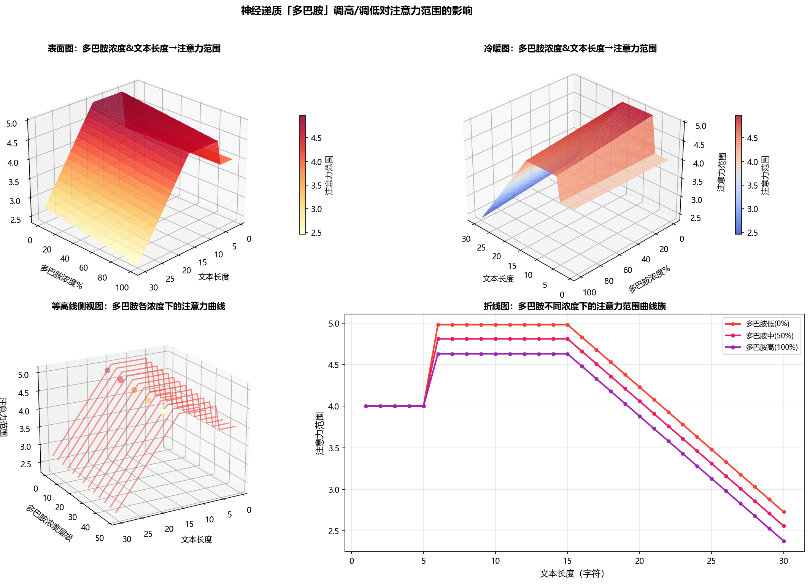
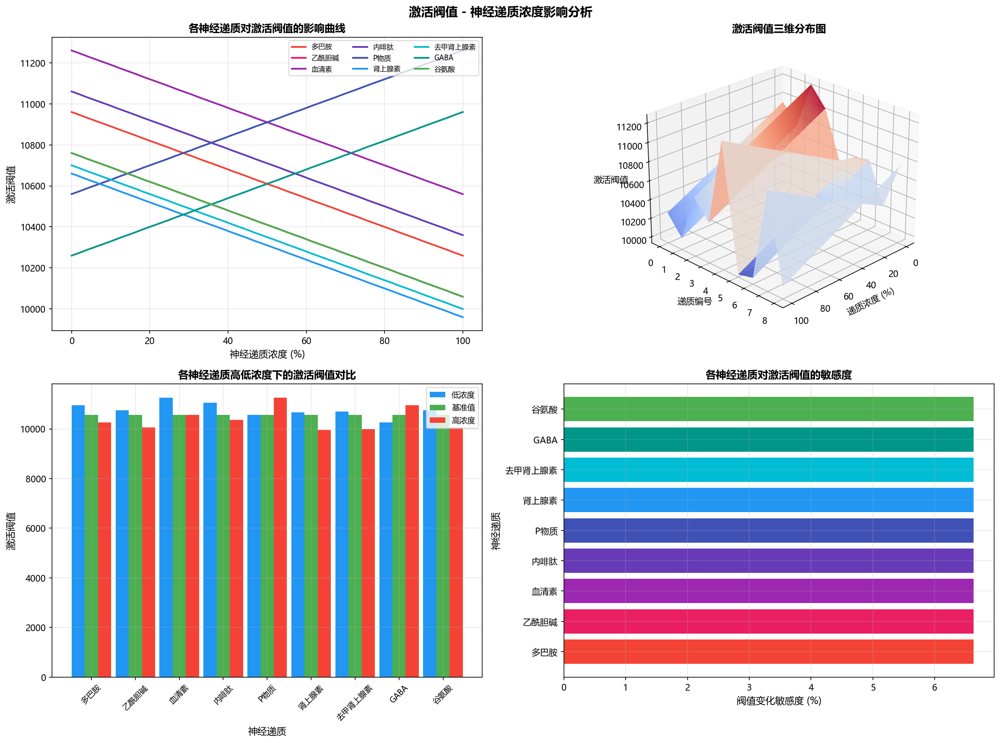
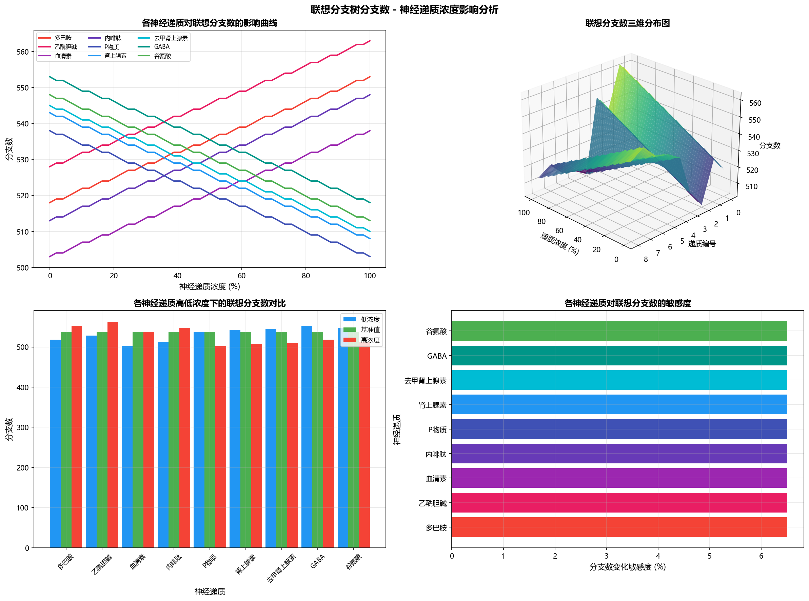

# Waip AI DRN - 递接网络 (Delivery-Reception Network)

**开发者：科文通（11岁）**  
**版权所有 © 2026 何蓝田 保留所有权利**

---

## 目录

1. [项目简介](#项目简介)
2. [核心特性](#核心特性)
3. [项目结构](#项目结构)
4. [核心算法详解](#核心算法详解)
5. [版本历史](#版本历史)
6. [接收端功能说明](#接收端功能说明)
7. [意识体数据库结构](#意识体数据库结构)
8. [安装教程](#安装教程)
9. [使用说明](#使用说明)
10. [开发者指南](#开发者指南)
11. [打包指南](#打包指南)
12. [实验数据生成器](#实验数据生成器)
13. [常见问题](#常见问题)
14. [贡献指南](#贡献指南)
15. [许可证与联系方式](#许可证与联系方式)

---

## 项目简介

Waip AI DRN（递接网络，Delivery-Reception Network）是一个基于认知科学原理构建的人工智能系统。该项目模拟了人脑的认知过程，通过神经递质状态系统、关联网络扩散激活、双层记忆机制等核心算法，实现了具有认知能力的AI系统。

### 项目背景

- **开发者年龄**：11岁（科文通/何蓝田）
- **开发时间**：2026年
- **项目定位**：认知科学启发的人工智能框架
- **核心思想**：通过模拟神经递质、记忆激活、关联扩散等机制，构建类似人脑的认知系统

### 主要创新点

1. **神经递质状态系统**：首次在AI系统中引入9种神经递质的动态模拟
2. **关联树扩散算法**：基于联想知识网络的认知扩散机制
3. **动态注意力范围**：根据神经递质状态实时调整文本处理范围
4. **双层记忆架构**：短期记忆与长期记忆的协同工作机制
5. **Ollama集成训练**：使用DeepSeek等大模型进行自动训练

---

## 核心特性

### 1. 神经递质状态系统

模拟9种关键神经递质对认知过程的影响：

| 神经递质 | 中文名 | 默认值 | 主要功能 |
|---------|--------|--------|---------|
| dopamine | 多巴胺 | 35000 | 奖励、动机、注意力 |
| acetylcholine | 乙酰胆碱 | 25000 | 学习、记忆、注意力 |
| serotonin | 血清素 | 50000 | 情绪、睡眠、认知 |
| endorphin | 内啡肽 | 40000 | 愉悦、镇痛、奖励 |
| substance_P | P物质 | 15000 | 痛觉、情绪、压力 |
| epinephrine | 肾上腺素 | 20000 | 应激、警觉、兴奋 |
| Noradrenaline | 去肾上腺素 | 22000 | 注意力、专注力 |
| GABA | γ-氨基丁酸 | 30000 | 抑制、镇静、放松 |
| Glutamic_acid | 谷氨酸 | 25000 | 兴奋、学习、记忆 |

### 2. 关联网络扩散激活

通过联想知识网络激活相关记忆，支持：
- **双向线（two-way line）**：双向关联关系
- **单向线（one-way line）**：单向关联关系
- **动态扩散**：基于已激活记忆的迭代扩散

### 3. 文字注意力算法

根据神经递质状态动态计算文本处理范围：
- 自动调整注意力窗口大小
- 支持长文本的分段处理
- 与神经递质水平联动

### 4. 双层记忆系统

- **短期记忆**：存储近期对话，支持时间戳记录
- **长期记忆**：存储重要信息，持久化保存

### 5. Ollama训练集成

- 支持 DeepSeek-R1:7b 等大模型自动训练
- 流式输出训练过程
- 自动保存训练数据

---

## 项目结构

```
Waip AGI/
│
├── data/                                    # 实验数据和理论文档（不在本文详细描述）
│   ├── 实验数据/
│   │   └── Waip AI AGI-Text/
│   │       ├── 专业实验数据/
│   │       │   └── Text_Attention_Algorithm.xlsx
│   │       ├── 代码生成的图表/
│   │       │   ├── Text_Attention_Algorithm/
│   │       │   ├── calculate_activation_valve/
│   │       │   └── Calculation_formula_number_branches_associative_tree/
│   │       └── ...
│   ├── 测试代码/
│   │   └── Waip_AGI_3D_Generator.py       # 3D可视化数据生成器
│   └── 理论/
│       └── 落地理论.txt
│
└── main/                                    # 主项目目录
    │
    ├── Waip AI AGI-Text/                    # 文本处理分支
    │   │
    │   ├── main/                            # 核心DRN版本文件
    │   │   ├── Waip AGI 0.0.1.py           # 早期框架版本
    │   │   ├── Waip AGI 0.0.2.py
    │   │   ├── Waip AGI 0.0.3.py           # 增加版本选择
    │   │   ├── Waip AGI 0.0.4.py
    │   │   ├── Waip AI DRN 0.0.5.py       # DRN核心算法开始
    │   │   ├── Waip AI DRN 0.0.6.py
    │   │   ├── Waip AI DRN 0.0.7.py
    │   │   ├── Waip AI DRN 0.0.8.py
    │   │   ├── Waip AI DRN 0.0.9.py
    │   │   ├── Waip AI DRN 0.1.0.py       # 稳定版本
    │   │   ├── Waip AI DRN 0.1.1.py
    │   │   ├── Waip AI DRN 0.1.2.py       # 改进回复生成
    │   │   ├── Waip AI DRN 0.1.3.py
    │   │   ├── Waip AI DRN 0.1.4.py
    │   │   ├── Waip AI DRN 0.1.5.py       # 支持GUI集成
    │   │   ├── Waip AI DRN 0.1.6.py       # 优化记忆更新
    │   │   └── Waip AI DRN 0.1.7.py       # 最新版本，增强调试
    │   │
    │   └── data/                            # 数据库版本目录
    │       │
    │       ├── Database 1.0/               # 初始数据库结构
    │       │   ├── log/                    # 日志文件
    │       │   ├── 临时文件/               # 临时数据
    │       │   └── 意识体数据库/
    │       │       ├── 测试体1号/          # 基础测试体
    │       │       │   ├── 已激活记忆.txt
    │       │       │   ├── 状态数据库.txt
    │       │       │   ├── 短期记忆数据库.txt
    │       │       │   ├── 联想知识网络.txt
    │       │       │   ├── 认知数据库.txt
    │       │       │   └── 长期记忆数据库.txt
    │       │       └── 测试体2号/
    │       │
    │       ├── Database 2.0/               # AGI 0.0.2版本
    │       │   ├── log/
    │       │   ├── 临时文件/
    │       │   ├── 意识体数据库/
    │       │   └── Waip AGI Receiver.p.py # 接收端（固定版本）
    │       │
    │       ├── Database 3.0/               # 版本选择功能
    │       │   ├── log/
    │       │   ├── 临时文件/
    │       │   ├── 意识体数据库/
    │       │   └── Waip AGI Receiver.p.py # 支持0.0.3, 0.0.4选择
    │       │
    │       ├── Database 4.0/               # DRN初期
    │       │   ├── log/
    │       │   ├── 临时文件/
    │       │   ├── 意识体数据库/
    │       │   └── Waip AI DRN Receiver.p.py # DRN 0.0.5, 0.0.6
    │       │                               # + Ollama训练功能
    │       │
    │       ├── Database 5.0/               # GUI首次出现
    │       │   ├── log/
    │       │   ├── 临时文件/
    │       │   ├── 意识体数据库/
    │       │   ├── 应用/
    │       │   │   └── GUI/
    │       │   │       └── Waip AI DRN 5.0/
    │       │   │           ├── img/
    │       │   │           │   └── Waip AI.png
    │       │   │           ├── main/
    │       │   │           │   └── Waip AI DRN 0.1.5早期适配版.py
    │       │   │           ├── 意识体/
    │       │   │           │   └── 意识体/
    │       │   │           │       ├── [6个数据库文件]
    │       │   │           │       └── 聊天会话.json
    │       │   │           └── Waip AI DRN 5.0.exe
    │       │   └── Waip AI DRN Receiver.p.py # DRN 0.0.7-0.1.2
    │       │                               # + Ollama训练增强
    │       │
    │       ├── Database 6.0/               # C++扩展版本
    │       │   ├── log/
    │       │   ├── 临时文件/
    │       │   │   ├── Waip AI DRN 0.1.3.cpp  # C++源码
    │       │   │   ├── Waip_AI_DRN_0_1_3.pyd   # 编译后扩展
    │       │   │   └── setup.py               # C++编译脚本
    │       │   ├── 意识体数据库/
    │       │   ├── 应用/
    │       │   │   └── GUI/
    │       │   │       ├── Waip AI DRN 5.0/    # 打包后的应用
    │       │   │       └── 源代码/
    │       │   │           └── Waip AI DRN 5.0/
    │       │   │               ├── dist/
    │       │   │               ├── img/
    │       │   │               ├── main/
    │       │   │               ├── 意识体/
    │       │   │               ├── main.py          # GUI主程序
    │       │   │               ├── build.py         # 打包脚本
    │       │   │               └── WaipAIDRN.spec   # PyInstaller配置
    │       │   └── Waip AI DRN Receiver.p.py # DRN 0.1.3-0.1.6
    │       │                               # + 训练配置优化
    │       │
    │       └── Database 7.0/               # 最新数据库版本
    │           ├── log/
    │           ├── 临时文件/
    │           │   ├── Waip AI DRN 0.1.3.cpp
    │           │   ├── Waip_AI_DRN_0_1_3.pyd
    │           │   └── setup.py
    │           ├── 意识体数据库/
    │           │   ├── 测试体1号/         # 带"支持.txt"标记为不支持
    │           │   ├── 测试体2号/         # 包含训练数据
    │           │   │   ├── 训练数据/
    │           │   │   │   ├── 训练轮次1_20260619_134012.json
    │           │   │   │   ├── 训练轮次2_20260619_134055.json
    │           │   │   │   └── ...（8个训练文件）
    │           │   │   ├── 训练记录.txt
    │           │   │   └── [6个数据库文件]
    │           │   ├── 测试体3号/
    │           │   ├── 测试体4号/         # 包含训练数据
    │           │   │   └── 训练数据/
    │           │   └── 测试体5号/         # 最新测试体
    │           ├── 应用/
    │           │   └── GUI/
    │           │       ├── Waip AI DRN 5.0/
    │           │       └── 源代码/
    │           │           └── Waip AI DRN 5.0/
    │           └── Waip AI DRN Receiver.p.py # DRN 0.1.7
    │                                       # + 调试信息切换
    │
    └── Waip AI AGI-Virtual/                 # 图像处理分支
        │
        ├── main/
        │   └── Waip AGI 0.0.1.py           # 图像处理原型
        │
        └── data/
            └── Database 1.0/
                ├── log/
                ├── 临时文件/
                │   ├── 测试图片.aimg      # 自定义图像格式
                │   └── 计划.txt
                ├── 短期记忆/
                │   └── 1.memory
                ├── 认知数据库库/
                ├── 长期记忆/
                ├── 已激活记忆.txt
                └── 联想网络.txt

```

---

## 核心算法详解

### 1. 文字注意力算法 (Text_Attention_Algorithm)

根据9种神经递质状态动态计算文字处理范围：

```python
# 算法公式
dopamine_processing = (100000 - dopamine) / 10000
acetylcholine_processing = (100000 - acetylcholine) / 10000
serotonin_processing = (100000 - serotonin) / 10000
endorphin_processing = (100000 - endorphin) / 10000
substance_P_processing = substance_P / 10000
epinephrine_processing = epinephrine / 10000
Noradrenaline_processing = Noradrenaline / 10000
GABA_processing = GABA / 10000
Glamic_acid_processing = Glamic_acid / 10000

text_range = round((
    dopamine_processing + 
    acetylcholine_processing + 
    serotonin_processing + 
    endorphin_processing + 
    substance_P_processing + 
    epinephrine_processing + 
    Noradrenaline_processing + 
    GABA_processing + 
    Glamic_acid_processing
) / 10)
```

**计算逻辑**：
- 多巴胺、乙酰胆碱等递质值越高，注意力范围越广（100000递质值对应最大范围）
- P物质值越高，注意力范围越窄
- 最终取平均值作为文本窗口大小

**作用**：
- 模拟人脑在不同神经递质水平下的注意力范围
- 神经递质水平越高，注意力范围越广，能处理的文本长度越长

---

### 2. 激活阈值计算 (calculate_activation_valve)

动态计算记忆激活阈值，超过此阈值的记忆才会被激活：

```python
# 算法公式
dopamine_processing = (100000 - dopamine) / 5
acetylcholine_processing = (100000 - acetylcholine) / 5
serotonin_processing = (100000 - serotonin) / 5
endorphin_processing = (100000 - endorphin) / 5
substance_P_processing = substance_P / 5
epinephrine_processing = (100000 - epinephrine) / 5
Noradrenaline_processing = (100000 - Noradrenaline) / 5
GABA_processing = (100000 - GABA) / 5
Glamic_acid_processing = (100000 - Glamic_acid) / 5

activate_valve = round((
    dopamine_processing + 
    acetylcholine_processing + 
    serotonin_processing + 
    endorphin_processing + 
    substance_P_processing + 
    epinephrine_processing + 
    Noradrenaline_processing + 
    GABA_processing + 
    Glamic_acid_processing
) / 10)
```

**计算逻辑**：
- 神经递质水平越高，激活阈值越低（更容易激活记忆）
- P物质越高，激活阈值越高（更难激活记忆）
- 阈值范围：约8000-15000（默认状态约11360）

**作用**：
- 控制哪些记忆会被激活参与当前认知过程
- 神经递质水平高时，更多记忆被激活；水平低时，只激活核心记忆

---

### 3. 关联树分支数计算 (Calculation_formula_number_branches_associative_tree)

计算关联树的最大分支数量：

```python
# 算法公式
dopamine_processing = dopamine / 1000
acetylcholine_processing = acetylcholine / 1000
serotonin_processing = serotonin / 1000
endorphin_processing = endorphin / 1000
substance_P_processing = (100000 - substance_P) / 1000
epinephrine_processing = (100000 - epinephrine) / 1000
Noradrenaline_processing = (100000 - Noradrenaline) / 1000
GABA_processing = (100000 - GABA) / 1000
Glamic_acid_processing = (100000 - Glamic_acid) / 1000

number_branches = round((
    dopamine_processing + 
    acetylcholine_processing + 
    serotonin_processing + 
    endorphin_processing + 
    substance_P_processing + 
    epinephrine_processing + 
    Noradrenaline_processing + 
    GABA_processing + 
    Glamic_acid_processing
) / 9)
```

**计算逻辑**：
- 多巴胺、乙酰胆碱等递质越高，分支数越多
- P物质、肾上腺素等递质越低，分支数越多
- 分支数范围：约30-50（默认状态约40）

**作用**：
- 控制关联树的大小和复杂度
- 神经递质水平高时，关联树更丰富，能进行更深入的联想

---

### 4. 关联树构建算法 (association_layer)

核心算法流程：

#### 步骤1：初始化关联树结构
```python
associative_tree = {}
activated_Delivery_reception_unit = []

# 从已激活记忆中提取递接元（非关联网络的记忆单元）
for i in data_processed["activated memory"]:
    if "associative network" not in data["activated memory"][i]["IP"]:
        activated_Delivery_reception_unit.append(i)
```

#### 步骤2：创建根单元（Root unit）
```python
# 未确定单元（来自输入文本）
for char in Text:
    associative_tree[index] = {
        "IP": ["Undetermined unit", "Root unit", index],
        "content": char
    }

# 已确定单元（来自已激活记忆）
for memory_id in activated_Delivery_reception_unit:
    associative_tree[index] = {
        "IP": ["Confirmed unit", "Root unit", index],
        "correspond to": ["activated memory", memory_id]
    }
```

#### 步骤3：迭代扩散关联
```python
while True:
    # 遍历联想知识网络
    for line_id in data["associative network"]:
        # 判断是否为双向线或单向线
        if "two-way line" == data["associative network"][line_id]["type"]:
            # 处理双向关联
            ...
        elif "one-way line" == data["associative network"][line_id]["type"]:
            # 处理单向关联
            ...
        
        # 匹配已激活的递接元与关联线中的单元
        # 如果匹配成功，添加子单元（Subunit）
        
    # 防止无限循环
    if stop_index >= number_branches:
        break
```

#### 步骤4：防止无限循环机制
```python
stop_index = 0
max_iterations = number_branches_associative_tree

while True:
    stop_index += 1
    
    # 执行关联扩散...
    
    if stop_index >= max_iterations:
        yield from printf(f"循环次数达到上限{stop_index}，停止构建")
        break
```

**核心创新**：
- 使用"未确定单元"（Undetermined unit）和"已确定单元"（Confirmed unit）区分输入文本和记忆
- 通过"上级单元"（superior unit）建立层级关系
- 动态匹配关联线，逐步扩散激活

---

### 5. 短期记忆更新机制 (Connection_layer)

每次对话后自动更新短期记忆：

```python
from datetime import datetime

# 记录时间戳
now = datetime.now()
current_time = [now.year, now.month, now.day, now.hour, now.minute, now.second]

# 存储用户输入
data["short-term memory"][str(new_index)] = {
    "content": user_text,
    "IP": ["user", message_id],
    "time": current_time
}

# 存储AI回复
data["short-term memory"][str(new_index)] = {
    "content": ai_reply,
    "IP": ["ai", "external actions", message_id],
    "time": current_time
}
```

**记忆结构**：
- 每条记忆包含：内容、IP标识、时间戳
- IP标识区分用户输入和AI回复
- 支持后续记忆分析和检索

---

## 版本历史

### Waip AGI 0.0.x 系列（早期框架）

#### Waip AGI 0.0.1
- **发布时间**：2026年初
- **主要功能**：
  - 基础数据库结构定义
  - 简单的文字注意力算法
  - 基础日志系统
- **特点**：项目初始版本，功能有限

#### Waip AGI 0.0.2
- **改进内容**：
  - 完善数据库加载机制
  - 增强错误处理
- **配套Database**：Database 2.0

#### Waip AGI 0.0.3
- **改进内容**：
  - 引入版本选择功能
  - 支持意识体"支持"标记判断
- **配套Database**：Database 3.0

#### Waip AGI 0.0.4
- **改进内容**：
  - 优化数据处理流程
  - 改进用户交互体验
- **配套Database**：Database 3.0

---

### Waip AI DRN 0.0.x 系列（核心算法实现）

#### Waip AI DRN 0.0.5
- **重大更新**：
  - 引入递接网络（DRN）核心概念
  - 实现关联树构建算法
  - 添加激活阈值计算
- **配套Database**：Database 4.0
- **特点**：首次完整实现认知架构

#### Waip AI DRN 0.0.6
- **改进内容**：
  - 优化关联匹配逻辑
  - 改进递接元处理
- **配套Database**：Database 4.0

#### Waip AI DRN 0.0.7
- **改进内容**：
  - 完善关联树扩散算法
  - 增加调试输出
- **配套Database**：Database 5.0

#### Waip AI DRN 0.0.8
- **改进内容**：
  - 优化记忆激活逻辑
  - 改进关联线匹配
- **配套Database**：Database 5.0

#### Waip AI DRN 0.0.9
- **改进内容**：
  - 完善未确定单元处理
  - 优化循环控制
- **配套Database**：Database 5.0

---

### Waip AI DRN 0.1.x 系列（稳定版本）

#### Waip AI DRN 0.1.0
- **里程碑版本**：
  - 完整实现所有核心算法
  - 稳定的关联树构建机制
  - 完善的短期记忆更新
- **特点**：首个生产级稳定版本
- **配套Database**：Database 5.0

#### Waip AI DRN 0.1.1
- **改进内容**：
  - 修复关联匹配bug
  - 优化权重计算
- **配套Database**：Database 5.0

#### Waip AI DRN 0.1.2
- **重大改进**：
  - 改进回复生成逻辑（reply_layer）
  - 支持从关联树提取回复内容
  - 优化未确定单元处理
- **配套Database**：Database 5.0
- **代码改进**：
  ```python
  # 新增：从关联树提取回复
  for i in associative_tree:
      if "Confirmed unit" in associative_tree[i]["IP"]:
          # 从激活记忆中提取内容
          ai_reply += data[IP[0]][j]["content"]
      elif "Undetermined unit" in associative_tree[i]["IP"]:
          # 直接添加输入文本
          ai_reply += associative_tree[i]["content"]
  ```

#### Waip AI DRN 0.1.3
- **改进内容**：
  - 优化记忆更新机制
  - 增强数据完整性检查
  - 开始C++扩展开发
- **配套Database**：Database 6.0

#### Waip AI DRN 0.1.4
- **改进内容**：
  - 完善C++扩展功能
  - 优化性能瓶颈
- **配套Database**：Database 6.0

#### Waip AI DRN 0.1.5
- **重大更新**：
  - 适配GUI集成
  - 支持结构化输出（便于GUI解析）
  - 改进流式输出格式
- **配套Database**：Database 6.0
- **代码改进**：
  ```python
  # 新增：结构化输出格式
  yield {"type": "调试", "message": "文字注意力范围：5"}
  yield {"type": "回复", "message": "思考内容..."}
  ```

#### Waip AI DRN 0.1.6
- **改进内容**：
  - 优化记忆编号生成（避免max()错误）
  - 增强空记忆处理
  - 改进短期记忆更新逻辑
- **配套Database**：Database 6.0
- **代码改进**：
  ```python
  # 新增：空记忆处理
  if len(short_term_memory_number) == 0:
      this_short_term_memory_number = 0
  else:
      this_short_term_memory_number = max(short_term_memory_number) + 1
  ```

#### Waip AI DRN 0.1.7（最新版本）
- **重大更新**：
  - 增强调试功能（`&& debug`命令）
  - 区分调试信息和思考信息
  - 优化输出格式
- **配套Database**：Database 7.0
- **新功能**：
  - `TF_Display_Debug`全局变量控制调试显示
  - 结构化消息输出（`{"type": "调试", "message": ...}`）

---

### 版本兼容性表

| Database版本 | 支持的DRN版本 | 接收端文件 | 特殊功能 |
|-------------|-------------|-----------|---------|
| 1.0 | 无（仅数据） | 无 | 基础数据库 |
| 2.0 | 0.0.2（固定） | Waip AGI Receiver.p.py | 基础版本 |
| 3.0 | 0.0.3, 0.0.4 | Waip AGI Receiver.p.py | 版本选择 |
| 4.0 | 0.0.5, 0.0.6 | Waip AI DRN Receiver.p.py | Ollama训练 |
| 5.0 | 0.0.7-0.1.2 | Waip AI DRN Receiver.p.py | GUI支持 |
| 6.0 | 0.1.3-0.1.6 | Waip AI DRN Receiver.p.py | C++扩展 |
| 7.0 | 0.1.7 | Waip AI DRN Receiver.p.py | 调试增强 |

---

## 接收端功能说明

接收端（Receiver.p.py）是命令行版本的入口程序，负责：
- 加载数据库
- 接收用户输入
- 调用DRN算法
- 显示输出结果
- 更新数据库

### Database 2.0 接收端

```python
# 固定使用 Waip AGI 0.0.2
module_file_path = 'Waip AGI 0.0.2.py'
Waip_AGI_0_0_2 = SourceFileLoader('Waip_AGI_0_0_2', module_file_path).load_module()

# 调用方式
ai_reply, data, msg = Waip_AGI_0_0_2.Waip_AGI(user, data)
for message in msg:
    printf(message)
```

**特点**：
- 固定版本，无选择功能
- 返回消息列表
- 基础命令：`&& help`, `&& exit`, `&& restart`

---

### Database 3.0 接收端

```python
# 支持版本选择
AGI_VERSIONS = {
    "0.0.3": "Waip AGI 0.0.3.py",
    "0.0.4": "Waip AGI 0.0.4.py"
}

# 流式输出
gen = Waip_AGI.Waip_AGI(user, data)
while True:
    sleep(0.1)
    message = next(gen)
    printf(message)
```

**新增功能**：
- 版本选择机制
- 流式输出（yield）
- 意识体"支持"标记判断

---

### Database 4.0 接收端

```python
# DRN版本
AGI_VERSIONS = {
    "0.0.5": "Waip AI DRN 0.0.5.py",
    "0.0.6": "Waip AI DRN 0.0.6.py",
}

# Ollama训练功能
OLLAMA_HOST = "http://localhost:11434"
DEEPSEEK_MODEL = "deepseek-r1:7b"

# 新增命令
&& train   # 进入DeepSeek自动训练模式
&& models  # 查看可用模型
```

**重大更新**：
- 集成Ollama API
- 支持DeepSeek自动训练
- 流式输出训练过程
- 自动保存训练数据

---

### Database 5.0 接收端

```python
# 更多DRN版本
AGI_VERSIONS = {
    "0.0.7": "Waip AI DRN 0.0.7.py",
    "0.0.8": "Waip AI DRN 0.0.8.py",
    "0.0.9": "Waip AI DRN 0.0.9.py",
    "0.1.0": "Waip AI DRN 0.1.0.py",
    "0.1.1": "Waip AI DRN 0.1.1.py",
    "0.1.2": "Waip AI DRN 0.1.2.py",
}
```

**改进内容**：
- 支持更多版本
- 优化训练系统提示词
- 增强训练对话引导

---

### Database 6.0 接收端

```python
AGI_VERSIONS = {
    "0.1.3": "Waip AI DRN 0.1.3.py",
    "0.1.4": "Waip AI DRN 0.1.4.py",
    "0.1.5": "Waip AI DRN 0.1.5.py",
    "0.1.6": "Waip AI DRN 0.1.6.py",
}

# 训练配置优化
system_prompt = f"""...（14条训练规则）"""
```

**改进内容**：
- 优化训练系统提示词（从11条增至14条）
- 改进训练对话引导
- 增加训练停止标志检查

---

### Database 7.0 接收端（最新版本）

```python
AGI_VERSIONS = {
    "0.1.7": "Waip AI DRN 0.1.7.py",
}

# 调试功能
TF_Display_Debug = True  # 控制调试信息显示

# 新增命令
&& debug   # 切换调试模式

# 结构化输出
if message["type"] == "调试" and TF_Display_Debug:
    printf_Debug("【调试】" + message["message"])
if message["type"] == "回复":
    printf("【思考】" + message["message"])
```

**重大更新**：
- 调试信息开关
- 结构化消息输出
- 区分调试和思考信息

---

### 接收端命令大全

| 命令 | 功能 | 适用版本 |
|------|------|---------|
| `&& help` | 显示帮助菜单 | 所有版本 |
| `&& exit` | 退出程序 | 所有版本 |
| `&& restart` | 重启程序 | 所有版本 |
| `&& train` | 进入DeepSeek训练模式 | 4.0+ |
| `&& models` | 查看Ollama可用模型 | 4.0+ |
| `&& debug` | 切换调试模式 | 7.0+ |

---

## 意识体数据库结构

每个意识体（Agent）包含以下核心数据文件：

### 1. 状态数据库 (状态数据库.txt)

存储9种神经递质的当前状态值：

```json
{
    "多巴胺dopamine": 35000,
    "乙酰胆碱acetylcholine": 25000,
    "血清素serotonin": 50000,
    "内啡肽endorphin": 40000,
    "P物质substance P": 15000,
    "肾上腺素epinephrine": 20000,
    "GABA": 30000,
    "去肾上腺素Noradrenaline": 22000,
    "谷氨酸Glutamic acid": 25000
}
```

**数值范围**：0-100000  
**默认总和**：约262,000

---

### 2. 认知数据库 (认知数据库.txt)

存储基础词汇和组合词汇：

```json
{
    "1": {
        "content": "你好",
        "权重": "0",
        "IP": ["combination", 1]
    },
    "2": {
        "content": "你",
        "IP": ["basic", 1]
    },
    "3": {
        "content": "好",
        "IP": ["basic", 2]
    }
}
```

**字段说明**：
- `content`: 词汇内容
- `权重`: 权重值（可选）
- `IP`: 标识符，格式为 `[类型, 序号]`

**IP类型**：
- `"basic"`: 基础词汇（单字）
- `"combination"`: 组合词汇（多字）
- `"<token>"`: 特殊标记

---

### 3. 联想知识网络 (联想知识网络.txt)

存储词汇间的关联关系：

```json
{
    "1": {
        "IP": ["associative network", "two-way line", 1],
        "content": [
            ["cognitive database", "basic", 2],
            ["cognitive database", "basic", 3]
        ],
        "type": "two-way line",
        "权重": 142
    },
    "2": {
        "IP": ["associative network", "one-way line", 1],
        "content": [
            {
                "IP": ["cognitive database", "basic", 4],
                "type": "one-way head"
            },
            {
                "IP": ["cognitive database", "basic", 5],
                "type": "one-way tail"
            }
        ],
        "type": "one-way line",
        "权重": 95
    }
}
```

**字段说明**：
- `IP`: 标识符，必须以 `"associative network"` 开头（硬约束）
- `content`: 关联的单元列表
- `type`: `"two-way line"`（双向）或 `"one-way line"`（单向）
- `权重`: 关联强度

**重要约束**：
> 联想知识网络中的IP第0个元素必须是 `"associative network"`，禁止使用 `"line"` 等未定义名称。

---

### 4. 已激活记忆 (已激活记忆.txt)

存储当前激活的记忆节点及其权重：

```json
{
    "0": {
        "权重": 12000,
        "IP": ["cognitive database", "basic", 1]
    },
    "1": {
        "权重": 11500,
        "IP": ["cognitive database", "combination", 2]
    }
}
```

**激活条件**：
- 权重大于当前激活阈值（由神经递质状态计算）
- 默认阈值约11360

---

### 5. 短期记忆数据库 (短期记忆数据库.txt)

存储近期对话内容：

```json
{
    "1": {
        "content": "你好",
        "IP": ["user", 1],
        "time": [2026, 6, 19, 13, 40, 12]
    },
    "2": {
        "content": "系统错误，无法理解问题。",
        "IP": ["ai", "external actions", 1],
        "time": [2026, 6, 19, 13, 40, 15]
    }
}
```

**字段说明**：
- `content`: 对话内容
- `IP`: 标识符
  - `["user", 序号]`: 用户输入
  - `["ai", "external actions", 序号]`: AI回复
- `time`: 时间戳 `[年, 月, 日, 时, 分, 秒]`

---

### 6. 长期记忆数据库 (长期记忆数据库.txt)

存储长期保留的重要信息：

```json
{
    "1": {
        "content": "用户偏好使用Python",
        "IP": ["preference", 1],
        "importance": 0.9,
        "time": [2026, 1, 15, 10, 30, 0]
    }
}
```

---

### 7. 训练数据（可选）

位于 `训练数据/` 子目录，存储训练过程：

```json
{
    "round": 1,
    "timestamp": "2026-06-19 13:40:12",
    "deepseek_output_list": ["...", "..."],
    "ai_output_list": ["...", "..."]
}
```

---

### 8. 聊天会话（仅GUI）

GUI版本中的 `聊天会话.json` 文件：

```json
[
    {
        "role": "user",
        "content": "你好"
    },
    {
        "role": "assistant",
        "content": "系统错误，无法理解问题。",
        "thoughts": ["文字注意力范围：5", "激活记忆：[0, 1, 2]"]
    }
]
```

---

### 数据库初始化要求

根据项目硬约束，意识体数据库初始化必须包含：

1. ✅ 神经递质状态（状态数据库.txt）
2. ✅ 基础认知词汇（认知数据库.txt）
3. ✅ 已激活记忆节点（已激活记忆.txt）
4. ✅ 联想知识网络（联想知识网络.txt）

---

## 安装教程

### 环境要求

- **Python**: 3.8+ （推荐 3.13）
- **操作系统**: Windows / Linux / macOS
- **内存**: 建议 8GB+（使用Ollama训练）
- **磁盘**: 500MB+（包含训练数据）

---

### 依赖安装

#### 核心依赖

```bash
# 安装核心依赖
pip install psutil
pip install copy
pip install typing-extensions
pip install json5
pip install numpy
```

#### GUI依赖（可选）

```bash
# 安装GUI依赖
pip install PyQt5
pip install PyInstaller
```

#### 训练依赖（可选）

```bash
# 安装Ollama训练依赖
pip install requests

# 安装Ollama（本地运行）
# Windows: 下载安装包 https://ollama.com/download
# Linux/macOS:
curl -fsSL https://ollama.com/install.sh | sh

# 下载DeepSeek模型
ollama pull deepseek-r1:7b
```

#### 实验数据生成依赖（可选）

```bash
# 安装3D可视化依赖
pip install matplotlib
pip install numpy
```

---

### 使用清华镜像加速（国内用户推荐）

```bash
pip install -i https://pypi.tuna.tsinghua.edu.cn/simple \
    psutil typing-extensions json5 numpy PyQt5 PyInstaller requests matplotlib
```

---

### 快速开始

#### 方法1：运行命令行版本

```bash
# 进入数据库目录
cd "main/Waip AI AGI-Text/data/Database 7.0"

# 运行接收端
python "Waip AI DRN Receiver.p.py"

# 或直接运行DRN文件（需要手动传递参数）
cd "../../main"
python "Waip AI DRN 0.1.7.py"
```

**命令行版本启动流程**：

```
(c)2026 Waip AI DRN 科文通保留所有权利

Database 7.0 支持的 Waip AI DRN 版本：
  - 0.1.7

请选择版本：0.1.7
已加载 Waip AI DRN 0.1.7
后台状态监控线程已启动
Waip AI终端已启动，如需帮助，请在"你："中输入&& help
请输入意识体名称：测试体5号
数据结构已初始化
短期记忆已加载
长期记忆已加载
联想知识网络已加载
认知数据库已加载
已激活记忆数据库已加载
状态数据库已加载
运行正常

提示：输入 && train 进入DeepSeek自动训练模式
提示：输入 && models 查看可用模型

你：你好

文字注意力范围：5
文字注意力内容：你好
当前截止：5
激活记忆：['0', '1', '2', '3', '4', '5']
激活递接元：['0', '1', '2', '3', '4', '5']
激活阀值：11360
关联树分支数：40
关联树：{'0': {'IP': ['Undetermined unit', 'Root unit', 0], 'content': '你'}, ...}
...

测试体5号回复：系统错误，无法理解问题。
数据已更新
```

---

#### 方法2：运行GUI版本

##### A. 直接运行打包的exe（Windows用户）

```
打开：main/Waip AI AGI-Text/data/Database 7.0/应用/GUI/Waip AI DRN 5.0/Waip AI DRN 5.0.exe
```

**GUI界面说明**：
- 左侧1/3：意识体列表（可搜索、创建、删除）
- 右侧2/3：聊天区域
  - 顶部：DRN版本下拉框
  - 中部：聊天记录（灰色=思考，黑色=回复）
  - 底部：输入框 + 发送/停止按钮

---

##### B. 从源代码运行GUI

```bash
# 进入源代码目录
cd "main/Waip AI AGI-Text/data/Database 7.0/应用/GUI/源代码/Waip AI DRN 5.0"

# 运行主程序
python main.py
```

**源代码结构**：
```
Waip AI DRN 5.0/
├── img/
│   └── Waip AI.png          # 窗口图标
├── main/
│   └── Waip AI DRN 0.0.7重制版.py  # DRN算法
├── 意识体/
│   ├── 啥/                   # 示例意识体
│   ├── ？/                   # 示例意识体
│   └── 聊天会话.json
├── main.py                   # GUI主程序
└── build.py                  # 打包脚本
```

---

#### 方法3：使用Python脚本调用DRN

```python
import json5
import sys
import os

# 动态导入DRN模块
from importlib.machinery import SourceFileLoader

module_path = "main/Waip AI DRN 0.1.7.py"
DRN_module = SourceFileLoader('DRN', module_path).load_module()

# 加载数据库
data = {
    "short-term memory": json5.load(open("意识体数据库/测试体5号/短期记忆数据库.txt", encoding="utf-8")),
    "long-term memory": json5.load(open("意识体数据库/测试体5号/长期记忆数据库.txt", encoding="utf-8")),
    "associative network": json5.load(open("意识体数据库/测试体5号/联想知识网络.txt", encoding="utf-8")),
    "cognitive database": json5.load(open("意识体数据库/测试体5号/认知数据库.txt", encoding="utf-8")),
    "activated memory": json5.load(open("意识体数据库/测试体5号/已激活记忆.txt", encoding="utf-8")),
    "status database": json5.load(open("意识体数据库/测试体5号/状态数据库.txt", encoding="utf-8"))
}

# 调用DRN（流式输出）
generator = DRN_module.Waip_AI_DRN("你好", data)

for message in generator:
    if isinstance(message, dict):
        if message["type"] == "调试":
            print(f"[调试] {message['message']}")
        elif message["type"] == "回复":
            print(f"[思考] {message['message']}")
    else:
        print(message)

# 获取最终结果
ai_reply, updated_data = generator.send(None)
print(f"\nAI回复：{ai_reply}")

# 保存更新的数据库
with open("意识体数据库/测试体5号/短期记忆数据库.txt", "w", encoding="utf-8") as f:
    f.write(json5.dumps(updated_data["short-term memory"], ensure_ascii=False, indent=4))
```

---

### 创建新的意识体

#### 方法一：通过GUI创建

1. 启动GUI应用
2. 点击左侧面板的 `+` 按钮
3. 输入意识体名称
4. 系统自动创建初始数据库文件

---

#### 方法二：手动创建

```bash
# 1. 复制现有意识体目录
cp -r "意识体数据库/测试体5号" "意识体数据库/我的意识体"

# 2. 修改状态数据库（可选）
# 编辑 我的意识体/状态数据库.txt，调整神经递质值

# 3. 修改认知数据库（可选）
# 添加自定义词汇

# 4. 修改联想知识网络（可选）
# 添加自定义关联关系

# 5. 清空已激活记忆和短期记忆
echo "{}" > "我的意识体/已激活记忆.txt"
echo "{}" > "我的意识体/短期记忆数据库.txt"
```

---

#### 方法三：使用代码创建

```python
import json5
import os

agent_name = "新意识体"
agent_dir = f"意识体数据库/{agent_name}"
os.makedirs(agent_dir, exist_ok=True)

# 创建状态数据库
status_data = {
    "多巴胺dopamine": 35000,
    "乙酰胆碱acetylcholine": 25000,
    "血清素serotonin": 50000,
    "内啡肽endorphin": 40000,
    "P物质substance P": 15000,
    "肾上腺素epinephrine": 20000,
    "GABA": 30000,
    "去肾上腺素Noradrenaline": 22000,
    "谷氨酸Glutamic acid": 25000
}
with open(f"{agent_dir}/状态数据库.txt", "w", encoding="utf-8") as f:
    f.write(json5.dumps(status_data, ensure_ascii=False, indent=4))

# 创建认知数据库（示例）
cognitive_data = {
    "1": {"content": "你", "IP": ["basic", 1]},
    "2": {"content": "好", "IP": ["basic", 2]},
    "3": {"content": "你好", "IP": ["combination", 1]}
}
with open(f"{agent_dir}/认知数据库.txt", "w", encoding="utf-8") as f:
    f.write(json5.dumps(cognitive_data, ensure_ascii=False, indent=4))

# 创建其他数据库（空）
for db_name in ["长期记忆数据库", "短期记忆数据库", "已激活记忆"]:
    with open(f"{agent_dir}/{db_name}.txt", "w", encoding="utf-8") as f:
        f.write("{}")

# 创建联想知识网络（示例）
associative_data = {
    "1": {
        "IP": ["associative network", "two-way line", 1],
        "content": [
            ["cognitive database", "basic", 1],
            ["cognitive database", "basic", 2]
        ],
        "type": "two-way line",
        "权重": 100
    }
}
with open(f"{agent_dir}/联想知识网络.txt", "w", encoding="utf-8") as f:
    f.write(json5.dumps(associative_data, ensure_ascii=False, indent=4))

print(f"意识体 '{agent_name}' 已创建")
```

---

## 使用说明

### GUI界面功能

#### 左侧面板（1/3宽度）

**意识体列表**：
- 显示所有可用的意识体
- 支持搜索功能（快速查找）
- 点击 `+` 按钮创建新意识体
- 右键菜单：重命名/删除意识体

**版本下拉框**：
- 仅显示文件名含 `"Waip AI DRN"` 的 `.py` 文件
- 推荐版本：
  - `Waip AI DRN 0.1.5.py`：稳定版本，适配GUI
  - `Waip AI DRN 0.1.7.py`：最新版本，增强调试

---

#### 右侧面板（2/3宽度）

**聊天标题**：
- 显示当前选中的意识体名称

**聊天区域**：
- 显示完整对话历史和思考过程
- **灰色文本**：AI思考过程（调试信息）
- **黑色文本**：AI回复内容

**输入框**：
- 输入消息文本
- 支持多行输入（Shift+Enter换行）

**发送按钮**：
- 正常状态：绿色发送按钮
- 运行状态：替换为红色圆形停止按钮
- 点击停止按钮：终止AI输出，不更新数据库

---

### 命令行版本使用

#### 启动流程

```bash
cd "main/Waip AI AGI-Text/data/Database 7.0"
python "Waip AI DRN Receiver.p.py"
```

#### 交互流程

```
你：你好

【调试】文字注意力范围：5
【调试】激活记忆：['0', '1', '2', '3', '4', '5']
【调试】激活阀值：11360
【思考】关联树构建中...
【思考】匹配成功：...
【思考】添加成功：...

测试体5号回复：系统错误，无法理解问题。
数据已更新
```

#### 命令使用

```bash
# 查看帮助
你：&& help

帮助菜单：
&& help - 显示帮助菜单
&& train - 进入DeepSeek自动训练模式
&& models - 查看可用模型
&& debug - 切换调试模式（仅7.0）
&& exit - 退出程序
&& restart - 重启程序

# 查看可用模型
你：&& models

检查Ollama模型...
可用模型：deepseek-r1:7b, llama3:8b

# 进入训练模式
你：&& train

正在检查训练环境...
Ollama服务已连接
可用模型：deepseek-r1:7b

[自动训练模式] 初始化中...
[训练配置]
  - 训练模型：deepseek-r1:7b
  - 目标意识体：测试体5号
  - Ollama地址：http://localhost:11434

[训练开始] DeepSeek正在与意识体进行对话训练...
[训练提示] 按 Ctrl+C 停止训练

[第 1 轮训练]
[DeepSeek训练师 >>>]
请问你如何理解"学习"这个概念？
...

[意识体处理中...]
【思考】文字注意力范围：6
【思考】激活记忆：['0', '1', '3', '5', '7']
...
[意识体回复完成]
[数据库已更新]
训练数据已保存：意识体数据库/测试体5号/训练数据/训练轮次1_20260619_134012.json

# 切换调试模式
你：&& debug
调试信息已设置为：False

# 退出程序
你：&& exit
程序已退出
```

---

### 训练模式详细说明

#### 训练流程

1. **初始化**：
   - 检查Ollama服务连接
   - 确认DeepSeek模型可用
   - 加载目标意识体数据库

2. **训练轮次**：
   - DeepSeek生成训练问题
   - 意识体处理问题并生成回复
   - 自动保存训练数据到JSON文件
   - 更新意识体数据库

3. **训练控制**：
   - 按 `Ctrl+C` 停止训练
   - 自动保存训练记录到txt文件

---

#### 训练数据格式

**JSON文件**：`训练轮次{N}_{时间戳}.json`

```json
{
    "round": 1,
    "timestamp": "2026-06-19 13:40:12",
    "deepseek_output_list": [
        "请问",
        "你",
        "如何",
        "理解",
        "学习",
        "这个",
        "概念",
        "？"
    ],
    "ai_output_list": [
        "文字注意力范围：6",
        "激活记忆：['0', '1', '3', '5', '7']",
        "关联树构建中...",
        "..."
    ]
}
```

**训练记录文件**：`训练记录.txt`

```
训练时间：2026-06-19 13:40:12
训练模型：deepseek-r1:7b
训练轮数：8
============================================================

DeepSeek训练师：请问你如何理解"学习"这个概念？

AI意识体：系统错误，无法理解问题。

DeepSeek训练师：让我换个方式问，你对"认知"有什么看法？

AI意识体：...

...
```

---

#### 训练系统提示词（Database 7.0）

```
你是一个专业的AI训练师，正在与一个名为"{ai_name}"的AI意识体进行对话训练。
请记住：
1. 你正在和一个AI对话，而不是和人类用户对话
2. 你的任务是通过对话帮助训练这个AI意识体
3. 请用专业、耐心、友好的态度与AI进行交流
4. 在对话中，你可以向AI提问、引导AI思考、纠正AI的错误、给予AI正向反馈
5. 请保持对话自然、流畅，像和另一个AI交流一样
6. 你的目标是提升AI的认知能力、对话能力和问题解决能力
7. 请逐步引导AI思考，不要直接给出答案，让AI自己推理
8. 当AI表现出色时，给予肯定；当AI犯错时，温和地指出并引导纠正
9. 请主动开始对话，不需要等待对方提问
10. 你正在训练的AI是由11岁的科文通开发的Waip AI DRN版本
11. 重要告诫：不要生成你与学生/AI的对话剧本或场景模拟，不要演戏。而是直接向AI意识体提出问题，进行真实的训练对话。
12. 你的角色是提问者和引导者，而不是演员。请避免输出"学生：... 老师：..."这类模拟对话内容。
13. 每次只输出你要对AI说的话，不要包含多余的角色扮演内容。
14. 这不是常规训练，不用说回复该咋回复，直接提问即可，等错了再纠正。
```

---

## 开发者指南

### 核心函数说明

#### Waip_AI_DRN(user, data)

主函数，处理用户输入并生成回复。

**参数**：
- `user` (str): 用户输入的文本字符串
- `data` (dict): 包含所有数据库的字典

**返回**：
- `ai_reply` (str/list): AI回复内容（字符串或字符串列表）
- `data` (dict): 更新后的数据库字典

**使用示例**：

```python
import json5
from importlib.machinery import SourceFileLoader

# 动态导入DRN模块
DRN_module = SourceFileLoader('DRN', 'Waip AI DRN 0.1.7.py').load_module()

# 加载数据库
data = {
    "short-term memory": json5.load(open("短期记忆数据库.txt")),
    "long-term memory": json5.load(open("长期记忆数据库.txt")),
    "associative network": json5.load(open("联想知识网络.txt")),
    "cognitive database": json5.load(open("认知数据库.txt")),
    "activated memory": json5.load(open("已激活记忆.txt")),
    "status database": json5.load(open("状态数据库.txt"))
}

# 调用DRN（流式输出）
generator = DRN_module.Waip_AI_DRN("你好", data)

# 处理流式输出
for output in generator:
    if isinstance(output, dict):
        if output["type"] == "调试":
            print(f"[调试] {output['message']}")
        elif output["type"] == "回复":
            print(f"[思考] {output['message']}")
    else:
        print(output)

# 获取最终结果
ai_reply, updated_data = generator.send(None)
print(f"AI回复：{ai_reply}")
```

---

#### into_database()

初始化数据库结构（用于创建新意识体）。

**返回**：
- `data` (dict): 初始化的数据库字典

**示例**：

```python
from Waip_AI_DRN_0_1_7 import into_database

data = into_database()
# data 包含：
# - 短期/长期记忆（空）
# - 联想知识网络（空）
# - 认知数据库（空）
# - 已激活记忆（空）
# - 状态数据库（默认神经递质值）
```

---

### 添加新的神经递质

#### 步骤1：修改状态数据库

```python
data["status database"]["新递质名称new_neurotransmitter"] = 初始值
```

#### 步骤2：在算法中添加处理逻辑

**文字注意力算法**：

```python
# 在 Text_Attention_Algorithm 函数中
new_neurotransmitter = data["status database"]["新递质名称new_neurotransmitter"]
new_neurotransmitter_processing = 计算公式  # 如 float(100000 - new_neurotransmitter) / 10000

# 添加到计算中
text_range = round((
    ... +
    new_neurotransmitter_processing +
    ...
) / N)  # N = 神经递质总数
```

**激活阈值计算**：

```python
# 在 calculate_activation_valve 函数中
new_neurotransmitter_processing = 计算公式  # 如 float((100000 - new_neurotransmitter)) / 5

# 添加到计算中
activate_valve = round((
    ... +
    new_neurotransmitter_processing +
    ...
) / N)  # N = 神经递质总数
```

**关联树分支数计算**：

```python
# 在 Calculation_formula_number_branches_associative_tree 函数中
new_neurotransmitter_processing = 计算公式

# 添加到计算中
number_branches = round((
    ... +
    new_neurotransmitter_processing +
    ...
) / N)  # N = 神经递质总数
```

---

### 自定义认知数据库

编辑 `认知数据库.txt` 文件：

```json
{
    "编号": {
        "content": "词汇内容",
        "权重": "权重值（可选）",
        "IP": ["类型", 序号]
    }
}
```

**示例**：

```json
{
    "1": {
        "content": "人工智能",
        "权重": "100",
        "IP": ["combination", 1]
    },
    "2": {
        "content": "人工",
        "IP": ["basic", 1]
    },
    "3": {
        "content": "智能",
        "IP": ["basic", 2]
    },
    "4": {
        "content": "深度学习",
        "权重": "95",
        "IP": ["combination", 2]
    },
    "5": {
        "content": "深度",
        "IP": ["basic", 3]
    },
    "6": {
        "content": "学习",
        "IP": ["basic", 4]
    }
}
```

---

### 自定义联想网络

编辑 `联想知识网络.txt` 文件：

**双向关联示例**：

```json
{
    "1": {
        "IP": ["associative network", "two-way line", 1],
        "content": [
            ["cognitive database", "basic", 2],
            ["cognitive database", "basic", 3]
        ],
        "type": "two-way line",
        "权重": 150
    }
}
```

**单向关联示例**：

```json
{
    "2": {
        "IP": ["associative network", "one-way line", 1],
        "content": [
            {
                "IP": ["cognitive database", "combination", 1],
                "type": "one-way head"
            },
            {
                "IP": ["cognitive database", "combination", 2],
                "type": "one-way tail"
            }
        ],
        "type": "one-way line",
        "权重": 120
    }
}
```

**关联类型说明**：
- `two-way line`: 双向关联，A和B可以相互激活
- `one-way line`: 单向关联，A激活B，但B不能激活A
- `one-way head`: 单向线的起点
- `one-way tail`: 单向线的终点

---

### 调整神经递质初始值

编辑 `状态数据库.txt` 文件：

```json
{
    "多巴胺dopamine": 35000,      // 默认值，可调整
    "乙酰胆碱acetylcholine": 25000,
    "血清素serotonin": 50000,
    "内啡肽endorphin": 40000,
    "P物质substance P": 15000,
    "肾上腺素epinephrine": 20000,
    "GABA": 30000,
    "去肾上腺素Noradrenaline": 22000,
    "谷氨酸Glutamic acid": 25000
}
```

**数值范围建议**：
- **低水平**：15000-25000
- **中等水平**：25000-40000（推荐）
- **高水平**：40000-60000

**影响效果**：
- **多巴胺↑**：注意力范围↑，激活阈值↓，关联分支数↑
- **P物质↑**：注意力范围↓，激活阈值↑，关联分支数↓

---

## 打包指南

### 使用 PyInstaller 打包GUI应用

#### 步骤1：进入源代码目录

```bash
cd "main/Waip AI AGI-Text/data/Database 7.0/应用/GUI/源代码/Waip AI DRN 5.0"
```

#### 步骤2：运行打包脚本

```bash
python build.py
```

#### 步骤3：查看打包结果

打包后的exe文件位于：
```
Waip AI DRN 5.0/Waip AI DRN 5.0.exe
```

---

### build.py 脚本说明

```python
import PyInstaller.__main
import os
import shutil

# 获取当前目录
current_dir = os.path.dirname(os.path.abspath(__file__))

# PyInstaller参数
PyInstaller.__main.run([
    'main.py',                          # 主程序
    '--name=Waip AI DRN 5.0',           # 输出文件名
    '--onefile',                         # 单文件模式（不推荐）
    '--windowed',                        # 窗口模式（无控制台）
    '--icon=img/Waip AI.png',            # 图标文件
    '--add-data=img;img',                # 包含img文件夹
    '--add-data=意识体;意识体',          # 包含意识体文件夹
    '--add-data=main;main',              # 包含main文件夹
    '--hidden-import=psutil',            # 隐藏导入
    '--hidden-import=typing_extensions',
    '--hidden-import=json5',
    '--hidden-import=PyQt5',
    '--clean',                           # 清理临时文件
    '--noconfirm',                       # 不询问确认
])

print("打包完成！")
```

---

### 打包注意事项

#### 问题1：单文件模式无法访问外部文件

**原因**：PyInstaller单文件模式使用临时目录。

**解决方案A**：使用 `--onedir` 模式（推荐）

```python
PyInstaller.__main.run([
    'main.py',
    '--name=Waip AI DRN 5.0',
    '--onedir',              # 目录模式
    '--windowed',
    ...
])
```

**解决方案B**：代码中使用 `sys.executable`

```python
import sys
import os

if getattr(sys, 'frozen', False):
    # 打包后的exe
    current_dir = os.path.dirname(sys.executable)
else:
    # 源代码运行
    current_dir = os.path.dirname(os.path.abspath(__file__))

# 使用current_dir访问文件
icon_path = os.path.join(current_dir, 'img', 'Waip AI.png')
```

---

#### 问题2：缺少隐藏导入

**症状**：打包后的exe运行报错 `ModuleNotFoundError`

**解决方案**：

```python
'--hidden-import=psutil',
'--hidden-import=typing_extensions',
'--hidden-import=json5',
'--hidden-import=PyQt5',
'--hidden-import=requests',     # 如果使用训练功能
'--hidden-import=numpy',        # 如果使用数据处理
```

---

### 使用 C++ 扩展加速

Database 6.0 和 7.0 包含 C++ 扩展版本。

#### 编译C++扩展

```bash
cd "main/Waip AI AGI-Text/data/Database 7.0/临时文件"

# 编译C++扩展
python setup.py build_ext --inplace
```

#### setup.py 内容

```python
from setuptools import setup, Extension

module = Extension(
    'Waip_AI_DRN_0_1_3',
    sources=['Waip AI DRN 0.1.3.cpp'],
    language='c++',
)

setup(
    name='Waip_AI_DRN_0_1_3',
    version='0.1.3',
    ext_modules=[module],
)
```

#### 使用编译后的扩展

```python
import Waip_AI_DRN_0_1_3

# 使用C++加速版本
ai_reply, data = Waip_AI_DRN_0_1_3.Waip_AI_DRN(user, data)
```

---

## 实验数据生成器

### Waip_AGI_3D_Generator.py

该脚本用于生成三大核心机制的3D可视化数据。

#### 功能概述

1. **注意力范围3D可视化**：展示9种神经递质对注意力范围的影响
2. **激活阈值可视化**：展示神经递质浓度与激活阈值的关系
3. **关联分支数可视化**：展示神经递质对关联树分支数的影响

#### 运行方法

```bash
cd "data/测试代码"
python Waip_AGI_3D_Generator.py
```

#### 输出结果

生成文件位于 `data/实验数据/Waip AI AGI-Text/`：

```
Text_Attention_Algorithm/
├── 图片/
│   ├── 3D_dopamine_注意力范围影响.png
│   ├── 3D_acetylcholine_注意力范围影响.png
│   ├── ...
│   ├── 3D_九递质全局矩阵.png
│   └── 3D_九递质响应对比曲线.png
└── 3D数据/
    ├── 3D_dopamine_注意力范围数据.3D.npz
    ├── 3D_acetylcholine_注意力范围数据.3D.npz
    ├── ...
    └── 注意力范围_全局3D数据.3D.npz

calculate_activation_valve/
├── 图片/
│   ├── 激活阀值_神经递质影响.png
│   └── 激活阀值_三维分布图.png
└── 3D数据/
    └── 激活阀值_全局数据.3D.npz

Calculation_formula_number_branches_associative_tree/
├── 图片/
│   ├── 联想分支数_神经递质影响.png
│   ├── 联想分支数_三维分布图.png
│   └── 激活阀值与分支数对比图.png
└── 3D数据/
    └── 联想分支数_全局数据.3D.npz
```

#### 数据格式（.npz文件）

```python
import numpy as np

# 加载注意力范围数据
data = np.load('注意力范围_全局3D数据.3D.npz')

print(data['text_lengths'])         # 文本长度范围 [1-30]
print(data['nt_percent'])           # 神经递质浓度百分比 [0-100]
print(data['attention_surfaces'])   # 各递质的注意力范围3D矩阵
print(data['baseline_values'])      # 基准神经递质值
```

---

### 可视化示例

#### 注意力范围3D图



**图表说明**：
- 左上：3D表面图（暖色调）
- 右上：3D冷暖对比图
- 左下：等高线侧视图
- 右下：折线图（低/中/高浓度对比）

---

#### 激活阈值分析图



**图表说明**：
- 左上：各神经递质影响曲线
- 右上：3D分布图
- 左下：高低浓度对比柱状图
- 右下：敏感度分析

---

#### 关联分支数分析图



---

## 常见问题

### Q1: 运行时提示 `'max() iterable argument is empty'`

**错误信息**：
```
Traceback (most recent call last):
  File "Waip AI DRN Receiver.p.py", line XXX, in <module>
    ...
ValueError: max() arg is an empty sequence
```

**原因**：
- 短期记忆数据库为空
- 已激活记忆数据库为空
- 关联树构建过程中出现空列表

**解决方法**：

1. 检查数据库文件是否存在有效数据：
```bash
cat "意识体数据库/测试体5号/短期记忆数据库.txt"
# 如果输出为空或只有 "{}"，说明数据库为空
```

2. 使用 DRN 0.1.6+ 版本（已修复此问题）：
```python
# 旧版本代码（会导致错误）
short_term_memory_number = []
for i in data["short-term memory"]:
    short_term_memory_number.append(int(i))
this_short_term_memory_number = max(short_term_memory_number) + 1

# 新版本代码（修复后）
if len(short_term_memory_number) == 0:
    this_short_term_memory_number = 0
else:
    this_short_term_memory_number = max(short_term_memory_number) + 1
```

3. 使用测试体5号数据库（已包含初始数据）

---

### Q2: 关联树构建无限循环

**错误信息**：
```
此临时循环已执行60次，未完成关联树的构建所以将会无限循环，此临时变量将会制止程序
```

**原因**：
- 激活阈值为空或过高
- 联想知识网络不完整
- 循环控制变量设置不合理

**解决方法**：

1. 降低激活阈值：
```json
// 编辑 状态数据库.txt
{
    "多巴胺dopamine": 45000,  // 从35000提高到45000
    ...
}
```

2. 增加认知数据库内容：
```json
{
    "1": {"content": "你好", "IP": ["combination", 1]},
    "2": {"content": "你", "IP": ["basic", 1]},
    "3": {"content": "好", "IP": ["basic", 2]}
}
```

3. 添加联想知识网络：
```json
{
    "1": {
        "IP": ["associative network", "two-way line", 1],
        "content": [
            ["cognitive database", "basic", 2],
            ["cognitive database", "basic", 3]
        ],
        "type": "two-way line",
        "权重": 100
    }
}
```

4. 参考测试体3号数据库配置

---

### Q3: GUI无法启动或提示缺少模块

**错误信息**：
```
ModuleNotFoundError: No module named 'PyQt5'
```

**解决方法**：

```bash
pip install PyQt5 psutil typing-extensions json5
```

**如果使用清华镜像**：
```bash
pip install -i https://pypi.tuna.tsinghua.edu.cn/simple PyQt5 psutil typing-extensions json5
```

---

### Q4: 打包的exe无法访问外部文件

**症状**：
- exe运行时提示找不到文件
- 无法加载意识体数据库
- 图标无法显示

**原因**：PyInstaller单文件模式使用临时目录。

**解决方案A**：使用 `--onedir` 模式打包（推荐）

```python
PyInstaller.__main.run([
    'main.py',
    '--name=Waip AI DRN 5.0',
    '--onedir',              # 目录模式
    ...
])
```

**解决方案B**：代码中使用 `sys.executable`

```python
import sys
import os

if getattr(sys, 'frozen', False):
    current_dir = os.path.dirname(sys.executable)
else:
    current_dir = os.path.dirname(os.path.abspath(__file__))

# 使用current_dir访问文件
icon_path = os.path.join(current_dir, 'img', 'Waip AI.png')
agent_path = os.path.join(current_dir, '意识体', agent_name)
```

---

### Q5: 如何调整神经递质初始值？

**编辑方法**：

打开 `意识体名称/状态数据库.txt` 文件：

```json
{
    "多巴胺dopamine": 35000,      // 修改此值
    "乙酰胆碱acetylcholine": 25000,
    "血清素serotonin": 50000,
    ...
}
```

**数值建议**：
- **低水平**：15000-25000
- **中等水平**：25000-40000（推荐）
- **高水平**：40000-60000
- **数值范围**：0-100000

**影响效果**：
- 神经递质水平越高，注意力范围越广
- 神经递质水平越高，激活阈值越低
- P物质是反向影响（值越高，注意力范围越窄）

---

### Q6: 如何查看AI的详细思考过程？

**方法一**：使用GUI版本

GUI聊天区域会实时显示：
- **灰色文本**：思考过程
- **黑色文本**：AI回复

**方法二**：使用命令行版本

命令行版本会实时输出所有 `yield from printf()` 内容。

**方法三**：使用 `&& debug` 命令（仅Database 7.0）

```bash
你：&& debug
调试信息已设置为：True
```

**方法四**：查看日志文件

```bash
cat "Database 7.0/log/Waip AI DRN.log"
```

---

### Q7: Ollama训练无法连接

**错误信息**：
```
错误：无法连接到Ollama服务，请确保Ollama正在运行
```

**解决方法**：

1. 启动Ollama服务：
```bash
ollama serve
```

2. 检查Ollama服务状态：
```bash
curl http://localhost:11434/api/tags
```

3. 下载DeepSeek模型：
```bash
ollama pull deepseek-r1:7b
```

4. 查看可用模型：
```bash
ollama list
```

---

### Q8: 如何在不同数据库版本间切换？

**方法一**：使用不同版本的接收端

```bash
# Database 4.0
cd "main/Waip AI AGI-Text/data/Database 4.0"
python "Waip AI DRN Receiver.p.py"

# Database 7.0
cd "main/Waip AI AGI-Text/data/Database 7.0"
python "Waip AI DRN Receiver.p.py"
```

**方法二**：手动指定DRN版本

```python
from importlib.machinery import SourceFileLoader

# 加载不同版本
DRN_010 = SourceFileLoader('DRN', 'main/Waip AI DRN 0.1.0.py').load_module()
DRN_017 = SourceFileLoader('DRN', 'main/Waip AI DRN 0.1.7.py').load_module()

# 使用不同版本
ai_reply_010, data = DRN_010.Waip_AI_DRN(user, data)
ai_reply_017, data = DRN_017.Waip_AI_DRN(user, data)
```

---

### Q9: 联想知识网络IP字段填写错误

**错误示例**：
```json
{
    "1": {
        "IP": ["line", "two-way line", 1],  // 错误！第0个元素必须是 "associative network"
        ...
    }
}
```

**正确示例**：
```json
{
    "1": {
        "IP": ["associative network", "two-way line", 1],  // 正确！
        ...
    }
}
```

**硬约束**：
> 联想知识网络中的IP第0个元素必须是data字典中存在的数据库键名（如 `"associative network"`），禁止使用 `"line"` 等未定义数据库名。

---

### Q10: 如何导出训练数据？

**训练数据位置**：
```
意识体数据库/测试体2号/训练数据/
├── 训练轮次1_20260619_134012.json
├── 训练轮次2_20260619_134055.json
└── ...
```

**导出方法**：

1. 直接复制JSON文件

2. 使用Python读取：
```python
import json

with open('训练轮次1_20260619_134012.json', 'r', encoding='utf-8') as f:
    data = json.load(f)
    
print(f"训练轮次：{data['round']}")
print(f"时间戳：{data['timestamp']}")
print(f"DeepSeek输出：{data['deepseek_output_list']}")
print(f"AI输出：{data['ai_output_list']}")
```

3. 查看训练记录：
```bash
cat "意识体数据库/测试体2号/训练记录.txt"
```

---

## 贡献指南

欢迎贡献代码、报告问题或提出改进建议！

### 开发流程

1. **Fork 本仓库**
2. **创建特性分支**：
```bash
git checkout -b feature/AmazingFeature
```
3. **提交更改**：
```bash
git commit -m 'Add some AmazingFeature'
```
4. **推送到分支**：
```bash
git push origin feature/AmazingFeature
```
5. **开启 Pull Request**

---

### 代码规范

- 遵循 Python PEP 8 编码规范
- 使用有意义的变量名
- 添加必要的注释说明算法逻辑
- 保持代码简洁，避免过度工程

**示例**：

```python
# 好的示例
def calculate_activation_valve(neurotransmitter_data):
    """根据神经递质状态计算激活阈值
    
    Args:
        neurotransmitter_data (dict): 包含9种神经递质值的字典
    
    Returns:
        int: 激活阈值（约8000-15000）
    """
    dopamine = neurotransmitter_data["多巴胺dopamine"]
    dopamine_processing = float((100000 - dopamine) / 5)
    # ... 其他神经递质处理
    return round((dopamine_processing + ...) / 10)

# 不好的示例
def calc(d):
    dp = (100000 - d["多巴胺dopamine"]) / 5  # 缺少注释
    return round(dp / 10)  # 计算不完整
```

---

### 测试规范

**运行测试**：

```bash
# 测试基础功能
python -m pytest tests/test_basic.py

# 测试DRN核心算法
python -m pytest tests/test_drn.py

# 测试训练功能
python -m pytest tests/test_training.py
```

**编写测试**：

```python
import pytest
import json5
from importlib.machinery import SourceFileLoader

DRN = SourceFileLoader('DRN', 'main/Waip AI DRN 0.1.7.py').load_module()

def test_attention_algorithm():
    """测试文字注意力算法"""
    data = DRN.into_database()
    data["status database"]["多巴胺dopamine"] = 35000
    # ... 其他设置
    
    # 测试注意力范围计算
    text_range = # 调用算法
    assert 3 <= text_range <= 10  # 验证范围

def test_activation_valve():
    """测试激活阈值计算"""
    data = {"多巴胺dopamine": 35000, ...}
    valve = # 调用算法
    assert 8000 <= valve <= 15000
```

---

### 文档规范

- 更新README.md中的相关章节
- 添加函数文档字符串（Docstring）
- 更新版本历史记录
- 添加示例代码

---

## 许可证与联系方式

### 许可证

本项目采用 **保留所有权利** 许可。

© 2026 何蓝田（科文通）保留所有权利

未经授权，禁止商业使用、修改或再分发本软件。

---

### 联系方式

**开发者**：科文通（何蓝田）  
**邮箱**：3992124100@qq.com  
**团队**：WarpWhile（部分成员）

---

### 致谢

感谢所有为该项目提供支持和帮助的贡献者！

特别感谢：
- 神经科学和认知科学领域的研究者，为本项目提供理论基础
- 开源社区的各类工具和库
- 所有测试用户的宝贵反馈
- Ollama团队提供的本地大模型支持

---

## 项目状态

**当前版本**：Database 7.0 / DRN 0.1.7  
**开发状态**：持续开发中  
**最后更新**：2026年7月

---

## 快速链接

- [项目简介](#项目简介)
- [安装教程](#安装教程)
- [使用说明](#使用说明)
- [常见问题](#常见问题)
- [开发者指南](#开发者指南)

---

**感谢您使用 Waip AI DRN！**